# AutoShorts Studio 🎬⚡

**AutoShorts Studio** is an all-in-one, enterprise-grade open-source video creation and streamer clip automation studio that autonomously generates high-retention Shorts, Reels, and TikToks from scratch or directly from live streams (YouTube, Twitch, Kick).

[](https://www.python.org/)
[](https://opensource.org/licenses/MIT)
[](https://streamlit.io/)
[](https://fastapi.tiangolo.com/)
[](https://ffmpeg.org/)
[](https://github.com/SYSTRAN/faster-whisper)

**English Documentation** | [Türkçe Dokümantasyon](README.md)

---

## 📌 Table of Contents
- [Overview & Vision](#-overview--vision)
- [Dual-Engine Architecture](#-dual-engine-architecture)
  - [1. AI Video Generator from Scratch](#1-ai-video-generator-from-scratch)
  - [2. Streamer Clips & Shorts Autopilot Engine](#2-streamer-clips--shorts-autopilot-engine)
- [Interfaces & Modes](#-interfaces--modes)
  - [WebUI (Streamlit)](#1-webui-streamlit)
  - [REST API (FastAPI)](#2-rest-api-fastapi)
  - [CLI (Command Line)](#3-cli-automation)
- [Installation Guide](#-installation-guide)
- [Configuration (`config.toml`)](#-configuration-configtoml)
- [YouTube Auto-Publisher Setup](#-youtube-auto-publisher-setup)
- [Docker Deployment](#-docker-deployment)
- [Project Directory Layout](#-project-directory-layout)
- [License](#-license)

---

## 💡 Overview & Vision

On modern short-form video platforms (YouTube Shorts, Instagram Reels, TikTok), consistent high-frequency publishing combined with high watch retention is the single most critical factor for algorithmic reach.

AutoShorts Studio solves this by automating two essential content creation paradigms:
1. **Fact, Story & Educational Shorts from Scratch**: Type any topic or prompt; the engine handles copywriting, stock video retrieval, voice synthesis, animated captions, background music ducking, and final video composition autonomously.
2. **Streamer Highlights & Viral Clip Autopilot**: Scrapes long streams (YouTube, Twitch, Kick), extracts peak high-energy/funny moments (hype detection) using acoustic volume analysis, trims sponsor intros and stream end cards, reformats horizontally shot gameplay into vertical 9:16 layout, stamps word-level karaoke subtitles, and uploads directly to YouTube on a scheduled quota.

---

## ⚙️ Dual-Engine Architecture

```mermaid
flowchart TD
    subgraph Engine1["Engine 1: AI Video Generator"]
        A[Topic / Prompt] --> B[LLM Script & Search Terms Generation]
        B --> C[Stock Video / Asset Search - Pexels/Pixabay]
        B --> D[Natural Voice Synthesis - TTS]
        D --> E[Faster-Whisper Word-Level Timestamps]
        C & D & E --> F[Dynamic BGM Ducking & Animated Subtitles]
        F --> G[HD Export: 9:16 / 16:9 / 1:1]
    end

    subgraph Engine2["Engine 2: Streamer Clips & Shorts Autopilot"]
        H[Stream Scraper: YouTube / Twitch / Kick] --> I{Smart Quality Filter}
        I -->|Freshness: Last 7 Days| J[FFmpeg ebur128 Hype Peak Detection]
        I -->|Blacklist: Announcements, Notices| X[Auto-Filtered]
        J --> K[Smart Intro / Outro Trimming]
        K --> L[9:16 Vertical Smart Framing]
        L --> M[Faster-Whisper Karaoke Captions]
        M --> N[YouTube Shorts Scheduled Auto-Publisher]
    end
```



---

### 1. AI Video Generator from Scratch

* **Multi-LLM Integration**: OpenAI (GPT-4o, GPT-4o-mini), Google Gemini 2.5, DeepSeek (V3 & R1), Anthropic Claude, Moonshot Kimi, xAI Grok, and local Ollama.
* **Smart Stock Media Sourcing**: Automatically finds and downloads relevant 1080p/4K footage from Pexels, Pixabay, or your local folder matching each sentence of the script.
* **TwelveLabs Multimodal Understanding**: Optional TwelveLabs Marengo integration semantically scores video segments to guarantee the most visually coherent clips make it to the timeline.
* **High-End Voice Synthesis (TTS)**:
  - **Microsoft Edge-TTS**: Free, unlimited, zero-key natural voices across 100+ languages and accents.
  - **Kokoro TTS**: Next-generation ultra-fast, local neural speech model.
  - **ElevenLabs**: Studio-grade emotion, cadence, and voice cloning.
  - **Azure Speech & OpenAI Audio**: Corporate-level speech engines.
* **Word-by-Word Karaoke Subtitles**: Faster-Whisper transcribes speech down to the millisecond, rendering TikTok/Shorts style bouncy, glowing karaoke animations with customizable fonts, stroke, shadow, and background box styles.
* **Smart Audio Ducking (BGM)**: Automatically ducks background music volume during spoken words and raises it back up during natural pauses.

---

### 2. Streamer Clips & Shorts Autopilot Engine

* **Multi-Platform Scraper**: Actively monitors YouTube channels, Twitch VODs/Clips, and Kick live streams.
* **Freshness & Virality Filtration**:
  - *Freshness Threshold*: Prioritizes recent streams (default: last 7 days).
  - *Virality Benchmark*: Filters out older low-traffic videos while retaining viral outliers (e.g. >50,000 views).
* **Title Blacklist**: Automatically discards non-entertainment broadcasts (e.g., technical notices, announcements, maintenance updates).
* **FFmpeg `ebur128` Hype Detection**: Analyzes audio loudness dynamics to locate screams, loud laughter, and climax action moments mathematically.
* **Smart Intro & Outro Trimming**: Strips fixed intro animations (e.g., first 5s) and outro end cards (e.g., last 6s) alongside dynamic silence and black-frame detection.
* **9:16 Vertical Cropping**: Converts 16:9 widescreen streams into clean, vertical portrait video with blurred backgrounds and centered action.
* **Faster-Whisper Auto-Captions**: Transcribes speech into high-contrast animated vertical subtitles.
* **Scheduled YouTube Shorts Publishing**: Manages daily quota limits (e.g., max 5 shorts/day), generating SEO-optimized titles, descriptions, and tags.

---

## 🖥️ Interfaces & Modes

### 1. WebUI (Streamlit)
Modern dark-themed interactive dashboard:
* **AI Video Generator Tab**: Type a topic, pick a voice and aspect ratio, click generate, and preview the final render.
* **Clips Automation Tab**: Manage monitored channels, configure loudness thresholds, set intro/outro trim lengths, and trigger background scrapers.

### 2. REST API (FastAPI)
Headless automation and integration for custom pipelines:
* `POST /api/v1/videos`: Dispatches a new video synthesis job.
* `GET /api/v1/tasks/{task_id}`: Polls task progress and status.
* `POST /api/v1/clips/discover`: Triggers stream scraping across channels.
* `POST /api/v1/clips/{clip_id}/render`: Renders clip into vertical Shorts format.
* `POST /api/v1/clips/{clip_id}/publish`: Uploads clip directly to YouTube Shorts.
* **Interactive Swagger UI**: Explore API at `http://127.0.0.1:8080/docs`.

### 3. CLI Automation
Headless terminal command:
```bash
python AutoShortsStudio/cli.py --video-subject "How Artificial Intelligence is Changing the World" --video-aspect 9:16
```

---

## 🚀 Installation Guide

### Requirements
- **OS**: Windows 10/11, macOS, or Linux (Ubuntu 22.04+ recommended)
- **Python**: 3.11 or newer
- **FFmpeg**: Must be available in system `PATH` or in `lib/ffmpeg/`.

### 1. Windows Portable Quickstart
1. Clone or download the repository.
2. Double-click `start.bat` in the root folder.
3. WebUI will open automatically at `http://127.0.0.1:8501`!

### 2. Manual Installation
```bash
# 1. Clone repository
git clone https://github.com/muratcihanyandi/AutoShorts-Studio.git
cd AutoShorts-Studio

# 2. Create virtual environment
python -m venv .venv
# On Windows:
.venv\Scripts\activate
# On Linux/macOS:
source .venv/bin/activate

# 3. Install dependencies
pip install -r AutoShortsStudio/requirements.txt

# 4. Launch WebUI
streamlit run AutoShortsStudio/webui/Main.py

# Alternatively, launch REST API
python AutoShortsStudio/main.py
```

---

## ⚙️ Configuration (`config.toml`)

On the first launch, `config.toml` is created automatically from `config.example.toml`. You can configure your credentials directly via the file or the WebUI:

```toml
# =============================================================================
# Core Service Settings
# =============================================================================
log_level = "INFO"
listen_host = "127.0.0.1"
listen_port = 8080

[app]
# LLM Provider: "openai", "gemini", "deepseek", "moonshot", "ollama", "azure"
llm_provider = "openai"
openai_api_key = "sk-..."
openai_model_name = "gpt-4o"

# Stock Footage Providers
pexels_api_keys = ["YOUR_PEXELS_KEY"]
pixabay_api_keys = ["YOUR_PIXABAY_KEY"]

# Clips & Shorts Automation Settings
max_video_age_days = 7                # Process only videos from the last 7 days
viral_threshold_for_older = 50000     # Require 50k+ views if video is older
title_blacklist = "announcement, update, notice, issue"
intro_trim_seconds = 5.0              # Trim initial intro seconds
outro_trim_seconds = 6.0              # Trim final outro seconds
enable_kick_discovery = false         # Enable Kick scraper (default: YouTube/Twitch)
```

---

## 🔑 YouTube Auto-Publisher Setup

AutoShorts Studio can automatically upload generated or cut Shorts directly to your channel:

1. Create a project in [Google Cloud Console](https://console.cloud.google.com/) and enable the **YouTube Data API v3**.
2. Create an **OAuth 2.0 Client ID** (Desktop application) and download the credentials JSON.
3. Save the downloaded file as `AutoShortsStudio/resource/client_secret.json`.
4. Run `auth_youtube.bat` (or `python AutoShortsStudio/authenticate_youtube.py`).
5. Authorize your channel in the browser prompt.
6. The token is saved securely, and scheduled uploads are immediately enabled.

---

## 🐳 Docker Deployment

### CPU Mode
```bash
docker compose up -d
```
Access the dashboard at `http://127.0.0.1:8501`.

### NVIDIA GPU Acceleration (CUDA 12.1)
Accelerate Whisper transcription and video rendering using GPU:
```bash
docker build -f AutoShortsStudio/Dockerfile.gpu -t autoshorts-studio:gpu AutoShortsStudio/
docker run --gpus all \
  -v $(pwd)/config.toml:/AutoShortsStudio/config.toml \
  -v $(pwd)/storage:/AutoShortsStudio/storage \
  -p 127.0.0.1:8501:8501 autoshorts-studio:gpu
```

---

## 📂 Project Directory Layout

```text
AutoShorts-Studio/
├── AutoShortsStudio/                 # Main core application package
│   ├── app/
│   │   ├── config/                   # Dynamic configuration manager
│   │   ├── controllers/v1/           # Video and Clip REST API endpoints
│   │   ├── models/                   # Pydantic schemas & data contracts
│   │   ├── services/                 # Core business services
│   │   │   ├── clip_downloader.py    # YouTube / Twitch / Kick downloader
│   │   │   ├── clip_editor.py        # FFmpeg video editor & subtitle burner
│   │   │   ├── clip_publisher.py     # YouTube Shorts automated uploader
│   │   │   ├── clip_scheduler.py     # Background autopilot cron scheduler
│   │   │   ├── hype_detector.py      # ebur128 audio peak energy detector
│   │   │   ├── llm.py                # Multi-LLM script generator
│   │   │   ├── material.py           # Stock media crawler & downloader
│   │   │   ├── subtitle.py           # Faster-Whisper karaoke subtitle generator
│   │   │   ├── video.py              # MoviePy video compositor
│   │   │   └── voice.py              # Edge-TTS / Kokoro / ElevenLabs engine
│   ├── webui/                        # Streamlit Web interface & custom components
│   ├── resource/                     # Fonts, audio effects, royalty-free BGM
│   ├── test/                         # 550+ unit and integration tests
│   ├── cli.py                        # Command-line interface
│   ├── main.py                       # FastAPI entrypoint
│   ├── pyproject.toml                # Project package metadata & dependencies
│   └── requirements.txt              # Standard Python dependencies
├── lib/                              # Bundled portable FFmpeg and Python binaries
├── api.bat                           # REST API launcher script
├── auth_youtube.bat                  # YouTube OAuth authentication script
├── start.bat                         # WebUI launcher script
└── update.bat                        # Dependency updater script
```

---

## 📄 License

Distributed under the [MIT License](LICENSE). Free for commercial and private use, modification, and distribution.
