# AutoShorts Studio 🎬⚡

**AutoShorts Studio**, yapay zeka destekli video üretimi ve yayıncı yayınlarından (YouTube, Twitch, Kick) tam otomatik Shorts, Reels ve TikTok klipleri oluşturan hepsi-bir-arada, kurumsal standartta açık kaynaklı video stüdyosudur.

[](https://www.python.org/)
[](https://opensource.org/licenses/MIT)
[](https://streamlit.io/)
[](https://fastapi.tiangolo.com/)
[](https://ffmpeg.org/)
[](https://github.com/SYSTRAN/faster-whisper)

[English Documentation](README-en.md) | **Türkçe Dokümantasyon**

---

## 📌 İçindekiler
- [Genel Bakış ve Vizyon](#-genel-bakış-ve-vizyon)
- [Çift Motor Mimarisi](#-çift-motor-mimarisi)
  - [1. Sıfırdan AI Video Üretici (AI Video Generator)](#1-sıfırdan-ai-video-üretici-ai-video-generator)
  - [2. Yayıncı Klip & Shorts Otopilotu (Streamer Clips Engine)](#2-yayıncı-klip--shorts-otopilotu-streamer-clips-engine)
- [Arayüzler ve Kullanım Modları](#-arayüzler-ve-kullanım-modları)
  - [WebUI (Görsel Arayüz)](#1-webui-streamlit)
  - [REST API (Geliştirici Arayüzü)](#2-rest-api-fastapi)
  - [CLI (Komut Satırı)](#3-cli-otomasyonu)
- [Kurulum Rehberi](#-kurulum-rehberi)
- [Yapılandırma (`config.toml`)](#-yapılandırma-configtoml)
- [YouTube Otomatik Yayıncı Kurulumu](#-youtube-otomatik-yayıncı-kurulumu)
- [Docker ile Dağıtım](#-docker-ile-dağıtım)
- [Proje Dosya Yapısı](#-proje-dosya-yapısı)
- [Lisans](#-lisans)

---

## 💡 Genel Bakış ve Vizyon

Sosyal medya platformlarında (YouTube Shorts, Instagram Reels, TikTok) organik büyümenin anahtarı **düzenli, yüksek kaliteli ve ilgi çekici video akışıdır**. 

AutoShorts Studio, iki temel içerik üretim ihtiyacını tek çatı altında toplar:
1. **Sıfırdan Bilgi & Eğlence Videoları**: Sadece bir konu veya anahtar kelime girerek metin yazarlığı, görsel eşleştirme, seslendirme, altyazı ve fon müziği adımlarını otonom yönetir.
2. **Yayıncı Kesitleri (Clips)**: YouTube, Twitch ve Kick yayınlarını arka planda tarar, en yüksek tempolu / kahkahalı / aksiyon dolu (hype) anları ses analiziyle yakalar, jenerikleri kırpar, dikey 9:16 formata odaklar, kelime kelime altyazılandırır ve doğrudan YouTube kanalınıza zamanlanmış olarak yükler.

---

## ⚙️ Çift Motor Mimarisi

```mermaid
flowchart TD
    subgraph Engine1["Motor 1: Sıfırdan AI Video Üretimi"]
        A[Konu / Fikir / Prompt] --> B[LLM Senaryo & Terim Üretimi]
        B --> C[Stok Video / Görsel Arama - Pexels/Pixabay]
        B --> D[TTS Doğal Seslendirme]
        D --> E[Faster-Whisper Kelime Zamanlaması]
        C & D & E --> F[Dinamik BGM Ducking & Animasyonlu Altyazı]
        F --> G[Render: 9:16 / 16:9 / 1:1 HD Video]
    end

    subgraph Engine2["Motor 2: Yayıncı Klip & Shorts Otopilotu"]
        H[Yayın Takibi: YouTube / Twitch / Kick] --> I{Filtreleme}
        I -->|Tazelik: Son 7 Gün| J[FFmpeg ebur128 Hype Analizi]
        I -->|Kara Liste: Açıklama, Duyuru| X[Otomatik Eleme]
        J --> K[Intro / Outro Akıllı Kırpma]
        K --> L[9:16 Dikey Akıllı Kadraj]
        L --> M[Faster-Whisper Karaoke Altyazı]
        M --> N[YouTube Shorts Otomatik Yükleyici]
    end
```



---

### 1. Sıfırdan AI Video Üretici (AI Video Generator)

* **Geniş LLM Desteği**: OpenAI (GPT-4o, GPT-4o-mini), Google Gemini 2.5, DeepSeek (V3 & R1), Anthropic Claude, Moonshot Kimi, xAI Grok ve yerel modeller için yerel Ollama desteği.
* **Akıllı Stok Medya Eşleştirme**: Pexels ve Pixabay API'leri ile senaryonun her cümlesine en uygun 1080p / 4K videoları otomatik arar, indirir ve sürelerini sahne temposuna göre keser. İsteğe bağlı yerel video/resim klasörlerinizi kullanabilir.
* **TwelveLabs Çok Modlu Video Anlama**: İsteğe bağlı TwelveLabs Marengo modeliyle indirilen videoların semantik içeriğini analiz ederek konuya en yüksek alaka düzeyine sahip sahneleri önceliklendirir.
* **Üst Düzey Seslendirme (TTS)**:
  - **Microsoft Edge-TTS**: Ücretsiz, sınırsız, API anahtarı gerektirmeyen yüzlerce doğal dil ve aksan.
  - **Kokoro TTS**: Yeni nesil ultra hızlı ve insan doğallığında açık kaynaklı yerel ses sentezi.
  - **ElevenLabs**: Profesyonel stüdyo kalitesinde duygulu ve klonlanmış sesler.
  - **Azure Speech & OpenAI Audio**: Kurumsal Microsoft ve OpenAI Alloy/Echo/Nova sesleri.
* **Kelime Bazlı Animasyonlu Altyazılar (Karaoke)**: Faster-Whisper motoru konuşmadaki her kelimenin başlangıç ve bitiş milisaniyesini çıkarır. TikTok ve Reels standartlarında kelime kelime parlayan, zıplayan karaoke altyazıları oluşturur. Yazı tipi, boyutu, kenar çizgisi (stroke), gölge ve arka plan kutucukları tamamen özelleştirilebilir.
* **Akıllı Arka Plan Müziği (Audio Ducking)**: Telifsiz müzik kütüphanesinden otomatik seçim yapar. Konuşmacı konuşurken müziğin sesini otomatik kısar (ducking), konuşma durduğunda müziği yükseltir.

---

### 2. Yayıncı Klip & Shorts Otopilotu (Streamer Clips Engine)

* **Çoklu Platform Canlı ve VOD Keşfi**: Takip ettiğiniz yayıncıların YouTube, Twitch veya Kick kanallarını düzenli periyotlarla tarar.
* **Tazelik ve Viralite Filtresi**:
  - *Tazelik Eşiği*: Varsayılan son 7 gün içindeki videolar incelenir (eski ve bayat içerikler elenir).
  - *Viralite Eşiği*: 7 günden eski videolar elenirken, belirlenen izlenme eşiğini (örneğin 50.000+) aşmış ekstrem viral anlar yakalanır.
* **Başlık Kara Listesi (Blacklist)**: "Açıklama", "duyuru", "sorun yaşıyorum", "bilgilendirme" gibi oyun dışı veya sıkıcı konuşma videoları otomatik olarak filtrelenir.
* **FFmpeg `ebur128` Hype Enerji Analizi**: Saatler süren yayınları tek tek izlemenize gerek kalmaz. FFmpeg'in entegre ses şiddeti algoritması, yayıncının kahkaha attığı, bağırdığı, chat'in coştuğu tepe enerji (hype) anlarını matematiksel tepe noktalarıyla milisaniye hassasiyetinde tespit eder.
* **Intro & Outro Temizleyici**:
  - Sabit kırpma süreleriyle yayın başlangıç ekranı (örneğin ilk 5 sn) ve bitiş jeneriği (örneğin son 6 sn) kesilir.
  - Dinamik siyah ekran (`blackdetect`) ve sessizlik (`silencedetect`) algoritmalarıyla boşta kalan donuk kareler otomatik temizlenir.
* **9:16 Dikey Akıllı Kadraj**: 16:9 yatay yayın görüntüsünü dinamik bulanık arka plan ve odaklanmış dikey format ile Shorts/Reels/TikTok standardına çevirir.
* **Otomatik Whisper Transkripsiyon**: Klipteki konuşmaları Faster-Whisper ile yazıya dökerek animasyonlu renkli altyazılar ekler.
* **YouTube Shorts Otomatik Yükleme**: Günlük kota koruması (örneğin günde maksimum 5 video), otomatik SEO uyumlu başlık, açıklama ve etiketlerle YouTube kanalınıza doğrudan video yükler.

---

## 🖥️ Arayüzler ve Kullanım Modları

### 1. WebUI (Streamlit)
Kullanıcı dostu, modern koyu tema grafik arayüz.
* **AI Video Oluşturucu Tabı**: Konu girin, ses ve format seçin, tek tıkla videoyu render edin ve önizleyin.
* **Klip Otomasyon Tabı**: Takip edilen kanalları yönetin, ses eşiklerini, kırpma sürelerini ve YouTube kota limitlerini ayarlayın; arka plan taramasını tek tıkla başlatın.

### 2. REST API (FastAPI)
Harici yazılımlar, botlar veya web servisleri ile entegrasyon için yüksek performanslı REST API:
* `POST /api/v1/videos`: Yeni bir video oluşturma görevi başlatır.
* `GET /api/v1/tasks/{task_id}`: Görevin ilerleme yüzdesini ve durumunu sorgular.
* `POST /api/v1/clips/discover`: Yayıncı kanallarından klip keşfini tetikler.
* `POST /api/v1/clips/{clip_id}/render`: Seçilen klibi dikey Shorts formatına render eder.
* `POST /api/v1/clips/{clip_id}/publish`: Klibi doğrudan YouTube Shorts'a yükler.
* **Swagger Dokümantasyonu**: `http://127.0.0.1:8080/docs` adresinden interaktif olarak test edilebilir.

### 3. CLI (Otomasyonu)
Arayüz açmadan terminal veya betik üzerinden video üretimi:
```bash
python AutoShortsStudio/cli.py --video-subject "Yapay Zeka Dünyayı Nasıl Değiştiriyor?" --video-aspect 9:16
```

---

## 🚀 Kurulum Rehberi

### Gereksinimler
- **İşletim Sistemi**: Windows 10/11, macOS veya Linux (Ubuntu 22.04+ önerilir)
- **Python**: 3.11 veya üzeri
- **FFmpeg**: Sistem yolunda (`PATH`) veya `lib/ffmpeg/` altında kurulu olmalıdır.

### 1. Windows Taşınabilir Başlangıç (En Kolay Yol)
1. Repoyu klonlayın veya indirin.
2. Kök dizindeki `start.bat` dosyasına çift tıklayın.
3. WebUI otomatik olarak `http://127.0.0.1:8501` adresinde açılacaktır!

### 2. Manuel Kurulum
```bash
# 1. Repoyu klonlayın
git clone https://github.com/muratcihanyandi/AutoShorts-Studio.git
cd AutoShorts-Studio

# 2. Sanal ortam oluşturup aktif edin
python -m venv .venv
# Windows için:
.venv\Scripts\activate
# Linux/macOS için:
source .venv/bin/activate

# 3. Bağımlılıkları yükleyin
pip install -r AutoShortsStudio/requirements.txt

# 4. WebUI'ı başlatın
streamlit run AutoShortsStudio/webui/Main.py

# Alternatif: REST API servisini başlatmak için
python AutoShortsStudio/main.py
```

---

## ⚙️ Yapılandırma (`config.toml`)

İlk çalıştırmada `config.example.toml` dosyasından otomatik olarak bir `config.toml` oluşturulur.
Kullanmak istediğiniz API anahtarlarını doğrudan bu dosyadan veya WebUI arayüzündeki ayarlar menüsünden belirleyebilirsiniz:

```toml
# =============================================================================
# Temel Servis Ayarları
# =============================================================================
log_level = "INFO"
listen_host = "127.0.0.1"
listen_port = 8080

[app]
# LLM Sağlayıcısı: "openai", "gemini", "deepseek", "moonshot", "ollama", "azure" vb.
llm_provider = "openai"
openai_api_key = "sk-..."
openai_model_name = "gpt-4o"

# Stok Medya Sağlayıcıları
pexels_api_keys = ["YOUR_PEXELS_KEY"]
pixabay_api_keys = ["YOUR_PIXABAY_KEY"]

# Klip ve Shorts Otomasyonu
max_video_age_days = 7                # Yalnızca son 7 günün videoları
viral_threshold_for_older = 50000     # 7 günden eski ise en az 50.000 izlenme
title_blacklist = "açıklama, sorun, duyuru, bilgilendirme, güncelleme"
intro_trim_seconds = 5.0              # Giriş jenerik kesme süresi
outro_trim_seconds = 6.0              # Bitiş ekranı kesme süresi
enable_kick_discovery = false         # Kick keşfi (varsayılan YouTube/Twitch)
```

---

## 🔑 YouTube Otomatik Yayıncı Kurulumu

AutoShorts Studio, üretilen veya kesilen Shorts videolarını doğrudan kanalınıza yükleyebilir:

1. [Google Cloud Console](https://console.cloud.google.com/) üzerinden yeni bir proje oluşturun ve **YouTube Data API v3** servisini etkinleştirin.
2. **OAuth 2.0 İstemci Kimliği** oluşturup JSON dosyasını indirin.
3. İndirdiğiniz dosyayı `AutoShortsStudio/resource/client_secret.json` olarak kaydedin.
4. Kök dizindeki `auth_youtube.bat` dosyasını çalıştırın (veya terminalden `python AutoShortsStudio/authenticate_youtube.py`).
5. Açılan tarayıcı penceresinde YouTube kanalınızı onaylayın.
6. Yetkilendirme token'ı otomatik olarak kaydedilecek ve sistem zamanlanmış yüklemelere hazır hale gelecektir.

---

## 🐳 Docker ile Dağıtım

### CPU Sürümü
```bash
docker compose up -d
```
Tarayıcınızda `http://127.0.0.1:8501` adresine gidin.

### NVIDIA GPU Hızlandırmalı Sürüm (CUDA 12.1)
Whisper transkripsiyonu ve video render işlemlerini ekran kartınızda koşturmak için:
```bash
docker build -f AutoShortsStudio/Dockerfile.gpu -t autoshorts-studio:gpu AutoShortsStudio/
docker run --gpus all \
  -v $(pwd)/config.toml:/AutoShortsStudio/config.toml \
  -v $(pwd)/storage:/AutoShortsStudio/storage \
  -p 127.0.0.1:8501:8501 autoshorts-studio:gpu
```

---

## 📂 Proje Dosya Yapısı

```text
AutoShorts-Studio/
├── AutoShortsStudio/                 # Ana uygulama kaynak kodu
│   ├── app/
│   │   ├── config/                   # Dinamik yapılandırma yöneticisi
│   │   ├── controllers/v1/           # Video ve Klip REST API endpoint'leri
│   │   ├── models/                   # Pydantic veri şemaları & tip tanımları
│   │   ├── services/                 # Çekirdek servisler
│   │   │   ├── clip_downloader.py    # YouTube / Twitch / Kick video indirici
│   │   │   ├── clip_editor.py        # FFmpeg video işleme ve altyazı giydirme
│   │   │   ├── clip_publisher.py     # YouTube Shorts otomatik yükleyici
│   │   │   ├── clip_scheduler.py     # Otopilot arka plan zamanlayıcısı
│   │   │   ├── hype_detector.py      # ebur128 ses tepe noktası analizi
│   │   │   ├── llm.py                # Çoklu LLM senaryo üretim motoru
│   │   │   ├── material.py           # Stok video arama & indirme
│   │   │   ├── subtitle.py           # Faster-Whisper karaoke altyazı motoru
│   │   │   ├── video.py              # MoviePy video sentezleyicisi
│   │   │   └── voice.py              # Edge-TTS / Kokoro / ElevenLabs TTS motoru
│   ├── webui/                        # Streamlit Web arayüzü & bileşenleri
│   ├── resource/                     # Fontlar, ses efektleri, telifsiz müzikler
│   ├── test/                         # 550+ birim ve entegrasyon test paketi
│   ├── cli.py                        # Komut satırı arayüzü
│   ├── main.py                       # FastAPI sunucu giriş noktası
│   ├── pyproject.toml                # Proje paket ve bağımlılık manifestosu
│   └── requirements.txt              # Python bağımlılık listesi
├── lib/                              # Taşınabilir yerel FFmpeg ve Python araçları
├── api.bat                           # REST API başlatma kısayolu
├── auth_youtube.bat                  # YouTube OAuth yetkilendirme kısayolu
├── start.bat                         # WebUI başlatma kısayolu
└── update.bat                        # Otomatik bağımlılık güncelleme kısayolu
```

---

## 📄 Lisans

Bu proje [MIT Lisansı](LICENSE) altında lisanslanmıştır. Açık kaynak standartlarına uygun olarak serbestçe kullanılabilir, geliştirilebilir ve dağıtılabilir.
